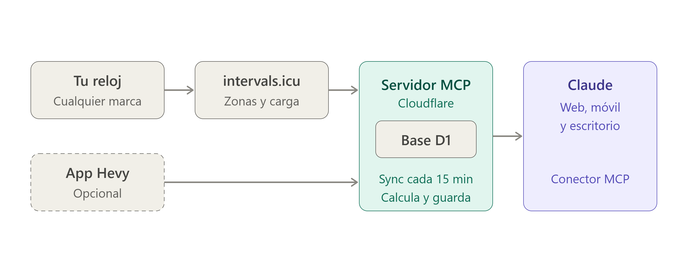
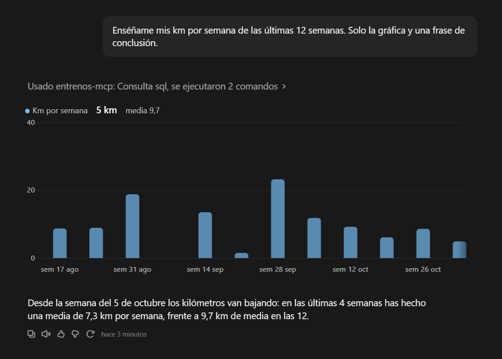
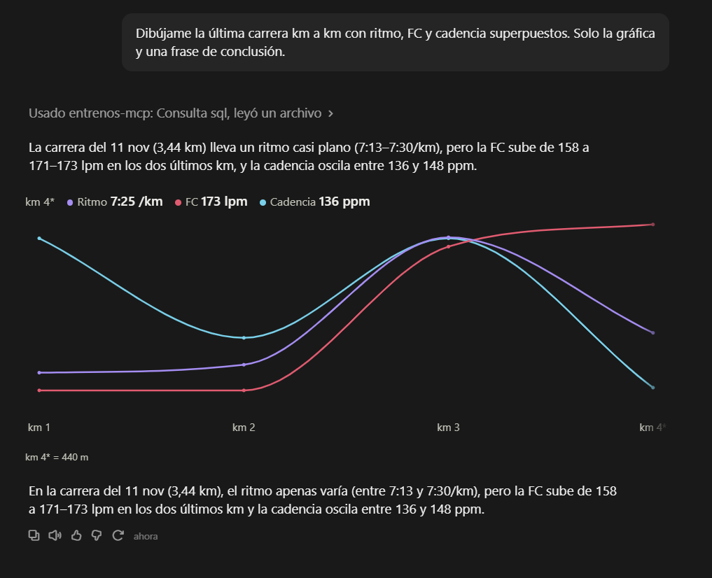
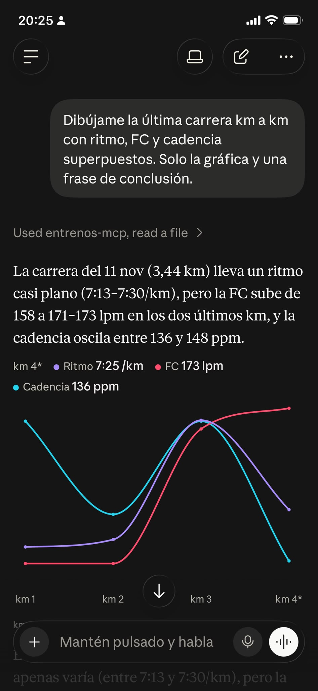
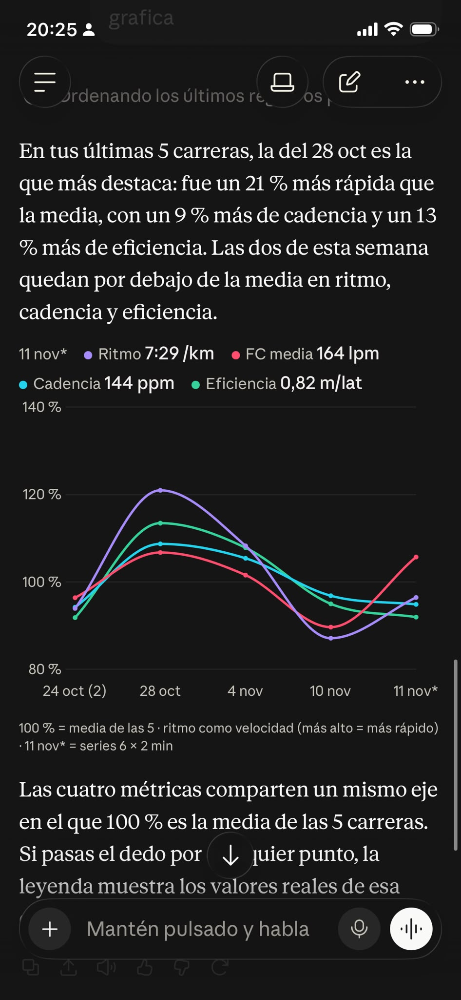

[English](README.md) · **Español**

# Training Coach MCP

**La arquitectura para montar tu propio entrenador con IA** en una cuenta gratis de Cloudflare. Trabaja con tus datos reales: los de tu reloj y, si quieres, los de tu app de gimnasio.

## Por qué existe

- **Conecta tu reloj con tu IA aunque la marca no lo permita.** Suunto y muchas otras apps deportivas no ofrecen una API abierta ni un conector oficial para tu IA. Pero casi todas sincronizan con **intervals.icu**, y este proyecto usa ese puente: tus datos de Suunto, Garmin, COROS, Polar o Wahoo llegan a Claude.
- **Sin servidor en casa.** No tienes que dejar un ordenador encendido ni montar nada en local: todo corre **en la nube, en Cloudflare**, gratis, y Claude lo usa desde la web, el móvil o el escritorio.

El núcleo es genérico. Sincroniza tus datos, los guarda en tu propia base de datos y deja que Claude los consulte con un conector MCP remoto, desde la web, el móvil o el escritorio.

El **entrenador de carrera y fuerza** de [`claude-ai/`](claude-ai/) es solo un ejemplo montado encima. Cópialo y adáptalo a tu deporte, tus objetivos y tus reglas.

## Míralo funcionando

Corre **en la nube** (Cloudflare), así que no hay nada que dejar encendido en casa. Son respuestas reales de Claude, preguntando en lenguaje normal desde un **ordenador** y desde un **móvil**:



**En el ordenador** (claude.ai):





**En el móvil** (app de Claude), con el mismo conector y sin ordenador de por medio:

<p>


</p>

Las capturas están en español porque es el idioma del autor; Claude responde en el idioma en que le escribas.

## Qué conecta

- **intervals.icu.** Recibe tus actividades de **Garmin, COROS, Polar, Suunto, Wahoo** y muchos más, y calcula carga, zonas y forma. Es la fuente principal.
- **Hevy** (opcional). Tus entrenos de fuerza y tus rutinas. Sin Hevy, todo lo demás funciona igual.

```
Reloj ─► app del reloj ─► intervals.icu ─┐
                                         ├─► Cloudflare Worker (sincroniza cada 15 min) ─► base D1
App Hevy (opcional) ─────────────────────┘                                                  │
                                                                                            ▼
                                             Claude (claude.ai) ◄── conector MCP ◄── herramientas
```

Tres capas, cada una con su función:

| Capa | Dónde | Qué hace |
|---|---|---|
| **Datos** | Servidor MCP + D1 (esta repo) | Sincroniza, guarda y calcula. Es igual para cualquier entrenador |
| **Reglas** | Instrucciones del proyecto en claude.ai | Quién es el entrenador y cómo responde |
| **Procedimientos** | Skills de claude.ai | Cómo se hace una tarea concreta, por ejemplo dibujar una gráfica |

Más detalle, en inglés, en [`docs/architecture.md`](docs/architecture.md) y [`docs/data-provenance.md`](docs/data-provenance.md).

## Herramientas que usa Claude

> **Nota:** los nombres de las herramientas, los campos y las salidas están en **español**, porque el proyecto nació así. A Claude le da igual: puedes hablarle en el idioma que quieras.

| Herramienta | Para qué | ¿Escribe? |
|---|---|---|
| `revisar_actividad` | Revisión completa de un entreno en una llamada: zonas de FC, parciales por km, deriva, recuperación de FC, comparación con entrenos parecidos de las 8 semanas anteriores, plan del día, forma y alertas | No |
| `estado_atleta` | Resumen para planificar: forma, carga de 7 y 28 días, recuperación (sueño, FC en reposo, VFC, pasos), último entreno duro, gimnasio reciente, notas, umbrales, sincronización y alertas | No |
| `historial` | Resumen por semanas: volumen, tirada larga, zonas y series de gimnasio por grupo muscular | No |
| `progreso` | Tendencia de una métrica (eficiencia, ritmo, FC, cadencia, km, carga, forma, FC en reposo, VFC) o de un ejercicio, solo con semanas terminadas | No |
| `ver_plan` | Tu calendario de intervals.icu y, en los días pasados, lo que hiciste de verdad | No |
| `tramos` | Analiza tramos que no son vueltas oficiales: perfil de ritmo, cadencia y FC, escalones detectados, medias exactas de un tramo o un patrón de series | No |
| `consulta_sql` | Cualquier otra pregunta, solo lectura, sobre una lista fija de vistas | No |
| `nota` | Notas que el entrenador recuerda entre chats (sensaciones, molestias, objetivos). También marca alertas como resueltas | **Sí** |
| `estado` | Estado compartido entre chats, con historial de versiones: objetivo, plan, rutina, decisiones y reglas | **Sí** |
| `programar_entrenos` | Crea, cambia o borra entrenos de tu calendario de intervals.icu en dos pasos: primero la vista previa y, cuando confirmas, el cambio. Solo toca entrenos futuros creados por él | **Sí** |
| `programar_rutinas` | Crea, cambia o restaura rutinas de Hevy en dos pasos, con una copia antes de cada cambio. **Solo aparece si configuras Hevy** | **Sí** |

## Requisitos

- Una cuenta de **intervals.icu** (gratis), conectada a tu reloj.
- Una cuenta de **Cloudflare** (gratis).
- **Node.js** LTS en tu ordenador, solo para instalarlo. Después no se ejecuta nada en tu ordenador.
- Una cuenta de **claude.ai** que permita añadir conectores personalizados.
- Opcional: **Hevy**.

## Instalación paso a paso

No hace falta saber programar: copiarás y pegarás unos comandos en una terminal. Lleva unos 20 minutos.

### 1. intervals.icu

1. Crea una cuenta en [intervals.icu](https://intervals.icu).
2. En **Settings → Connections**, conecta tu reloj (Garmin, COROS, Polar, Suunto…). Empezarán a llegar tus actividades.
3. **Pon tus umbrales.** En **Settings**, en los ajustes del deporte de carrera (y de cualquier otro que hagas), rellena tu **FC umbral (LTHR)**, tu **FC máxima** y tu **ritmo umbral**. El MCP saca tus zonas de ahí y no tiene nada escrito a mano: si están mal, el análisis también lo estará.
4. Al final de **Settings**, en **Developer Settings**, crea tu **API key** y tenla a mano.

### 2. Hevy (opcional)

En la app de Hevy, abre **Ajustes → Developer** y genera tu **API key**. Si te saltas este paso, el entrenador funciona igual, solo que sin datos de gimnasio ni rutinas.

### 3. Cloudflare y Node.js

1. Crea una cuenta gratis en [dash.cloudflare.com/sign-up](https://dash.cloudflare.com/sign-up).
2. Instala **Node.js LTS** desde [nodejs.org](https://nodejs.org). Para comprobarlo, abre una terminal y escribe `node --version`.
3. Descarga esta repo: botón verde **Code** → **Download ZIP**, y descomprímela. Abre una terminal dentro de esa carpeta.

### 4. Instalar e iniciar sesión

```bash
npm install
```

```bash
npx wrangler login
```

El segundo comando abre el navegador para que des acceso a tu cuenta de Cloudflare.

### 5. Crear la base de datos (D1)

```bash
npx wrangler d1 create entrenos
```

Al terminar, te enseña un texto con una línea parecida a esta (el tuyo tendrá otras letras y números):

```
database_id = "1a2b3c4d-1234-5678-9abc-def012345678"
```

Copia lo que va **entre las comillas**. Lo vas a pegar en el paso siguiente.

### 6. Editar `wrangler.toml` (la configuración)

**Qué es:** `wrangler.toml` es un archivo de texto con la configuración de tu servidor. Está dentro de la carpeta que descomprimiste en el paso 3.

**Cómo abrirlo:**
- **Windows:** clic derecho sobre `wrangler.toml` → **Abrir con** → **Bloc de notas**.
- **Mac:** clic derecho → **Abrir con** → **TextEdit**.
- O con cualquier editor de código, como VS Code.

**Reglas, antes de tocar nada:**
- Cambia **solo lo que va entre comillas**, y deja las comillas.
- No toques nada más: ni los nombres, ni los corchetes, ni el resto de líneas.
- Lo que va después de `#` en una línea son comentarios: explicaciones que el servidor no lee.

**1. El ID de la base de datos.** Busca esta línea:

```toml
database_id = "PEGA_AQUI_EL_ID"   # el que te da: npx wrangler d1 create entrenos
```

Sustituye `PEGA_AQUI_EL_ID` por el ID que copiaste en el paso 5. Debe quedar así, con tu ID:

```toml
database_id = "1a2b3c4d-1234-5678-9abc-def012345678"   # el que te da: npx wrangler d1 create entrenos
```

**2. Tu zona horaria y tu reloj.** Más abajo, en el apartado `[vars]`, verás esto:

```toml
TZ = "UTC"                        # tu zona horaria, p. ej. "America/Mexico_City" o "Europe/London"
WATCH = ""                        # marca del reloj: "suunto" si es un Suunto (explica el feel en su escala); si no, vacío
```

Por ejemplo, para alguien en España con un reloj Suunto debe quedar así:

```toml
TZ = "Europe/Madrid"              # tu zona horaria, p. ej. "America/Mexico_City" o "Europe/London"
WATCH = "suunto"                  # marca del reloj: "suunto" si es un Suunto (explica el feel en su escala); si no, vacío
```

- **`TZ` (zona horaria):** la plantilla trae `"UTC"`, que es la hora universal, sin horario de verano. **Cámbiala por la tuya**: de ella depende qué es "hoy" para tu entrenador y en qué día cae cada entreno. Escríbela tal cual, con mayúsculas y la barra:

  | Si vives en… | Escribe |
  |---|---|
  | España (península y Baleares) | `"Europe/Madrid"` |
  | México (centro) | `"America/Mexico_City"` |
  | Argentina | `"America/Argentina/Buenos_Aires"` |
  | Colombia | `"America/Bogota"` |
  | Reino Unido | `"Europe/London"` |
  | Nueva York (costa este de EE. UU.) | `"America/New_York"` |

  Si no está la tuya, búscala en la columna "TZ identifier" de [esta lista](https://en.wikipedia.org/wiki/List_of_tz_database_time_zones).
- **`WATCH` (reloj):** solo importa si tu reloj es un Suunto: entonces escribe `"suunto"`. Con cualquier otro reloj, déjalo como está, `""`.

**3. Desde cuándo importar tu histórico.** En el mismo apartado `[vars]` está esta línea:

```toml
HISTORY_START = "2018-01-01"      # desde cuándo importar el histórico
```

Pon la fecha en que **empiezan de verdad tus datos** en intervals.icu, por ejemplo `"2024-01-01"` si empezaste a usar el reloj en 2024. La importación avanza 6 meses cada 15 minutos: si la dejas en 2018 y tus datos son recientes, esperarás horas sin ver nada. Con la fecha justa, en unos minutos tienes todo.

**4. Guarda el archivo.** En el Bloc de notas, usa **Archivo → Guardar**, no "Guardar como". Comprueba que el archivo se sigue llamando `wrangler.toml` y no `wrangler.toml.txt`: si ves `.txt` al final, quítalo al renombrarlo.

### 7. Crear las tablas

```bash
npm run db:init
```

### 8. Guardar los secretos (el token y las API keys)

Los secretos son contraseñas que se guardan cifradas en Cloudflare, nunca en un archivo de la carpeta.

**Primero, el token del MCP.** Es una contraseña que **te inventas tú**: no te la da ninguna web. Protege tu servidor, y luego irá al final de la URL del conector (paso 10). Quien tenga esa URL puede leer tus datos.

1. **Genérala.** En Windows, abre PowerShell y ejecuta:

   ```powershell
   -join ((1..32) | % { '{0:x2}' -f (Get-Random -Max 256) })
   ```

   En Mac o Linux, en la terminal:

   ```bash
   openssl rand -hex 32
   ```

   Te sale una línea de 64 letras y números: ese es tu token. También vale un generador de contraseñas, con solo letras y números y 40 caracteres o más.
2. **Cópiala y guárdala** en tu gestor de contraseñas o en una nota privada. La necesitarás en el paso 10, y Cloudflare no te la vuelve a enseñar.
3. **Dásela a Cloudflare.** Ejecuta:

   ```bash
   npx wrangler secret put MCP_TOKEN
   ```

   Cuando pregunte `Enter a secret value`, pégala y pulsa Enter. **Es normal que no se vea nada al pegar**: está oculta a propósito.
4. Si te pregunta si quieres crear el Worker porque todavía no existe, responde que sí (`Y`).

**Después, las API keys.** Haz lo mismo con cada una; aquí no tienes que inventarte nada, pegas la que ya tienes:

```bash
npx wrangler secret put INTERVALS_API_KEY
```

Pega la API key de intervals.icu del paso 1.

```bash
npx wrangler secret put HEVY_API_KEY
```

Pega la API key de Hevy del paso 2. Sáltatelo si no usas Hevy.

**Si te equivocas** al pegar alguna, vuelve a ejecutar el mismo comando: el valor nuevo sobrescribe al anterior.

### 9. Publicar

```bash
npm run deploy
```

Te enseña tu URL: `https://entrenos-mcp.<tu-subdominio>.workers.dev`. Para comprobar que funciona, abre `https://entrenos-mcp.<tu-subdominio>.workers.dev/health` en el navegador. Debe salir `{"ok":true,...}`.

**El histórico se importa solo, por tramos.** Cada 15 minutos importa unos 6 meses de actividades y hasta 80 entrenos de Hevy, así que si tu `HISTORY_START` (paso 6) está años antes de tus primeros datos, tardará horas en llegar a ellos. Mientras tanto, `estado_atleta` dice por dónde va.

### 10. Conectarlo a claude.ai

1. **Monta la URL de tu conector.** Parte de la dirección que abriste en el paso 9 para comprobar `/health` y cambia solo el final: **quita `health` y pon `mcp/` seguido de tu token** (el del paso 8).

   | | Ejemplo (subdominio y token inventados) |
   |---|---|
   | Lo que abriste en el paso 9 | `https://entrenos-mcp.abc123.workers.dev/health` |
   | Lo que pegas en el conector | `https://entrenos-mcp.abc123.workers.dev/mcp/3f9a1c7e5b2d8a4f6c0e9b1d7a3f5c2e8b4d6a0f1c3e5b7d9a2c4e6f8b0d1a3c` |

   - El token tiene que ser **exactamente el mismo** que pegaste en `npx wrangler secret put MCP_TOKEN`.
   - Sin espacios, sin `<` `>` y sin barra al final.
   - **No compartas esta URL** con nadie ni la pegues en un chat: quien la tenga puede leer tus datos.

2. En claude.ai, abre **Settings → Connectors** → **Add custom connector**. Ponle el nombre que quieras, pega la URL del punto anterior y deja vacío todo lo de OAuth.

3. En los permisos de las herramientas del conector, pon las que escriben (`nota`, `estado`, `programar_entrenos`, `programar_rutinas`) en **"Preguntar siempre"**.
4. Crea un **proyecto** en claude.ai. Pega las instrucciones de ejemplo de [`claude-ai/es/instrucciones-proyecto.md`](claude-ai/es/instrucciones-proyecto.md) adaptadas a ti y, si quieres gráficas, añade la skill [`graficas`](claude-ai/es/skills/graficas/).

Prueba a preguntarle: *"¿Cómo ha evolucionado mi press banca en los últimos 3 meses?"* o *"¿Me estoy pasando esta semana sumando gimnasio y carrera?"*

## Coste

**0 € en el plan gratis de Cloudflare.** No pide tarjeta, así que no te puede cobrar. El uso queda muy por debajo de los límites:

- 100.000 peticiones al día. La sincronización gasta unas 100, más tus preguntas.
- 500 MB de base de datos, que dan para muchos años de entrenos.
- Un límite de CPU por ejecución. Por eso el histórico se importa por tramos.

Un aviso: los parciales por km se calculan con los datos segundo a segundo de intervals.icu. En una actividad muy larga (un ultra de muchas horas) podría pasarse del límite de CPU del plan gratis. En ese caso la revisión sale sin parciales y lo demás funciona igual.

intervals.icu es gratis. Hevy es opcional.

## Seguridad

- **El token va en la URL, así que la URL es tu contraseña: no la compartas.** Quien tenga la URL completa puede leer tus entrenos y también escribir: guardar notas, cambiar el estado compartido, tocar los entrenos del MCP en tu calendario de intervals.icu y cambiar tus rutinas de Hevy.
- Si se filtra, cámbialo con `npx wrangler secret put MCP_TOKEN` y actualiza el conector en claude.ai.
- Pon las herramientas que escriben en **"Preguntar siempre"** en claude.ai, para que Claude no cambie nada sin que lo veas antes.
- Con un token incorrecto el servidor responde 404, y `/health` no enseña datos. `/mcp` admite 60 peticiones por minuto y por IP, lo que también frena a quien intente adivinar el token.
- Las API keys se guardan como secretos cifrados en Cloudflare, no en el código.
- `consulta_sql` solo acepta una consulta `SELECT`/`WITH` sobre una lista de vistas permitidas. D1 no tiene modo de solo lectura, así que ese filtro es la única defensa: tenlo en cuenta si lo cambias.

## No es consejo médico

Es un proyecto personal para analizar tus propios datos de entrenamiento. **No es consejo médico y no sustituye a un médico, un fisioterapeuta ni un entrenador titulado.** La IA se puede equivocar. Si tienes dolor, síntomas raros o algún problema de salud, ve a un profesional.

## Mantenimiento

```bash
npm run logs        # ver en directo lo que hace (sincronizaciones, errores)
npm run deploy      # publicar cambios del código
npm run typecheck   # tipos + tests
npm run db:init     # aplicar migraciones nuevas a la base de datos
npx wrangler d1 export entrenos --remote --output=copia.sql   # copia de seguridad de tus datos
```

## Probar en local

```bash
cp .dev.vars.example .dev.vars           # rellena tus claves
npm run db:init:local
npm run dev                              # MCP en http://localhost:8787/mcp/<MCP_TOKEN>
curl "http://localhost:8787/__scheduled?cron=*/15+*+*+*+*"   # lanza una sincronización
```

## Problemas frecuentes

### `/health` da `ERR_SSL_VERSION_OR_CIPHER_MISMATCH` en una cuenta de Cloudflare nueva

Al abrir `https://entrenos-mcp.<tu-subdominio>.workers.dev/health`, el navegador dice "Este sitio web no puede proporcionar una conexión segura".

- **Causa:** tu subdominio workers.dev es nuevo y todavía no tiene el certificado. Cloudflare tarda en crearlo desde unos minutos hasta unos 30.
- **Solución:** espera, cierra la pestaña y vuelve a abrirla. El Worker ya funciona aunque el navegador falle.

### claude.ai no consigue conectar con el conector

Casi siempre es la URL:

- Comprueba que acaba en `/mcp/` + tu token, y no en `/health`.
- El token debe ser exactamente el que guardaste con `npx wrangler secret put MCP_TOKEN`. Si no estás seguro, vuelve a ejecutar ese comando con un token nuevo y usa ese en la URL.
- Sin espacios ni barra al final.

<!-- Añade aquí más casos: ### Síntoma, y después **Causa** y **Solución**. -->

## Limitaciones

- Las métricas que calcula solo la app de tu marca de reloj (por ejemplo, su propia puntuación de recuperación) no llegan a intervals.icu, así que tampoco al entrenador. Sí llegan los datos del archivo de la actividad: FC, GPS, cadencia, altitud, vueltas…
- Los umbrales configurados en el propio reloj no se usan. Se usan los de intervals.icu.
- La API de Hevy no deja borrar rutinas ni cambiarlas de carpeta. Eso se hace en la app.

## Licencia

[MIT](LICENSE).
